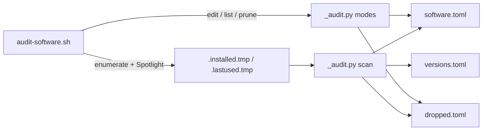
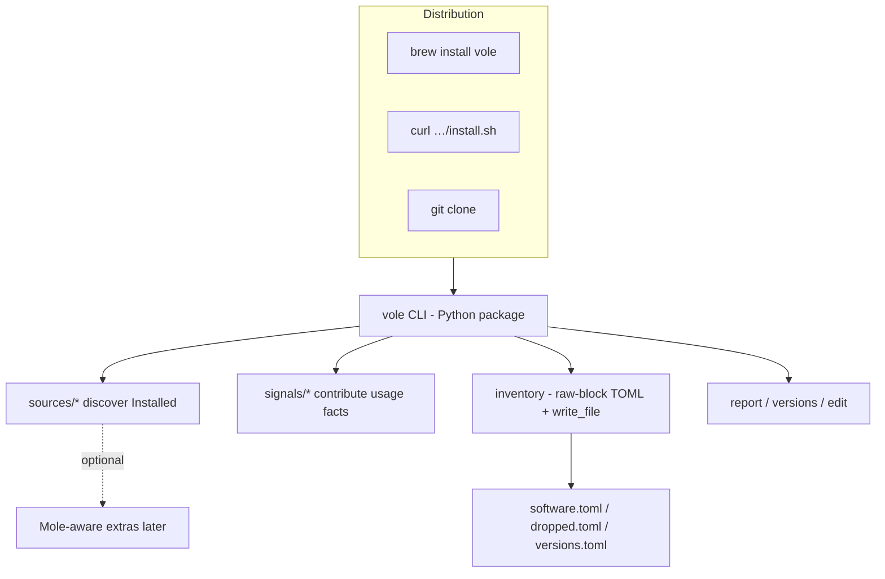

# Architecture and tech-stack review

- **Task ID:** `architecture-review`
- **Status:** done
- **Parent / blocked by:** <!-- none -->

## Problem

The tool works and is tested, but its shape was never designed — it accreted inside a personal
repo, one feature at a time, and is now about to be published. Several decisions that were
reasonable for one user on one machine are now public API: the two-language split, the hand-rolled
TOML handling, the macOS-only assumptions, and the way the two halves talk to each other.

Publishing freezes some of these. A contributor's first question will be "why is enumeration in
shell and everything else in Python?", and right now the answer lives nowhere.

## Goal

A written verdict on each structural decision — keep, change, or record as deliberate — and an
ADR for the ones worth keeping, so the next reader does not have to reverse-engineer the reasoning.
Plus a target architecture that can grow new sources and features and ship via GitHub / Homebrew.

## Open questions

Do not implement the restructure while any row is `open`. Flip to `locked` when the user accepts.

| # | Topic | Status | Decision |
|---|--------|--------|----------|
| 1 | Is this macOS-only on purpose, permanently? | locked | **macOS-only.** Core is independent of [Mole](https://github.com/tw93/Mole); optional later features may integrate with Mole (which is Mac-only) |
| 2 | Does the shell half survive? | locked | **No.** Drop the separate shell enumerator; one Python CLI owns discovery + audit |
| 3 | How is it distributed? | locked | **Homebrew formula + optional curl install script** (Homebrew-style: script fetched and run directly). Git clone remains fine for contributors |
| 4 | Who does the review? | locked | This task: summarize current shape, propose an extendable target architecture |

## Non-goals

- Not implementing the restructure in this task — verdict + ADRs + backlog only.
- Not feature work (new sources, Mole integration) beyond naming them as extension points.
- Not performance. A full scan is ~2 s.

---

## Current architecture (as shipped today)



| Piece | Role | Size |
|-------|------|------|
| `audit-software.sh` | Mode dispatch, brew/app/bin/npm/mise/ollama enumeration, Spotlight last-used, temp TSV handoff | ~159 lines POSIX sh |
| `_audit.py` | Raw-block TOML IO, edit/list/prune, usage signals, staleness, version diff, report | ~562 lines |
| Data files | Hand-written reasons (`software.toml`, `dropped.toml`); machine versions (`versions.toml`) | product |
| `tests/test_audit.py` | Helpers via `exec` up to `END OF HELPERS`; subprocess for file-only modes | ~27 tests |

**Handoff:** shell writes `source⇥name⇥version` lines; Python diffs against the curated file and
signals. Implicit, positional, tab-unsafe, undocumented.

**What works well today:** zero deps; inventory never re-serialized as a model; atomic sorted
writes; behavioural rules born from real bugs (see below).

**What does not:** untested shell half; script-as-module (`sys.argv` at import time); no seam to
add a source without editing the shell `enumerate()` function; awkward to ship as `vole` via brew.

---

## Target architecture

One installable CLI, one language, explicit extension points. Data files and their write path
stay sacred.



### Layout

```
vole/                      # importable; `python -m vole` / console_script `vole`
  __main__.py
  cli.py                   # argparse: scan, --report, --list, edit, --prune-dropped, --check
  inventory.py             # split_entries, set_field, toml_key, write_file  (unchanged contract)
  audit.py                 # discover → signal → classify → maybe write → print
  sources/
    base.py                # Protocol + Installed(name, source, versions)
    brew.py                # formulae + casks (+ cask→app dedupe)
    apps.py                # /Applications, App Store receipt bit
    bins.py                # ~/go/bin, ~/.local/bin
    npm_global.py
    mise.py
    ollama.py
  signals/
    base.py                # Protocol → optional dated / dependency facts
    spotlight.py
    shell_history.py
    app_state.py
    config_refs.py
    project_git.py
  versions.py              # diff_prev / format / write (extracted, unit-tested)
install.sh                 # curl installer: place `vole` on PATH, create empty inventory if needed
```

### Extension contracts

**Source** — add a file under `sources/`, register it in the registry. Implement:

```text
discover(home: Path) -> Iterable[Installed]
  Installed = (source_id, name, versions: list[str])
```

No TSV. Discovery is pure enough to feed fixtures in tests (fake home / stubbed
`subprocess`). Adding “cargo installed binaries” or “pipx” is one module, not a shell edit.

**Signal** — add under `signals/`, register. Implement:

```text
collect(home, entries) -> SignalMap   # name → dated facts and/or dependency facts
```

Staleness policy stays in `audit.py` (combine weak signals, respect `keep`, threshold). Signals
never write the inventory.

**Optional Mole extras** — separate modules (or a `integrations/mole.py`) that only activate when
Mole is present / a flag is set. Core scan must not require Mole. Documented as Mac-only add-ons.

### Distribution

| Path | Behaviour |
|------|-----------|
| Homebrew | Formula installs the `vole` package / script; data files live under a stable user path (e.g. `~/.config/vole/` or cwd — **open in `homebrew-formula`**) |
| `install.sh` | `curl -fsSL …/install.sh \| sh` fetches a release or main, installs the CLI, prints next steps |
| Clone | `python -m vole` / editable install for contributors |

### Testing seams

- Inventory helpers: import normally (no `END OF HELPERS` exec hack).
- Sources: unit-test with fixture trees / mocked command output.
- Signals: fixture home directories.
- Full live scan: still optional / manual; not required for CI.

### Python floor

**3.9+**, the Command Line Tools `/usr/bin/python3` every Homebrew user already has. That keeps
the curl install free of a Python prerequisite. `tomllib`-based features (`--check`, some tests)
need 3.11+ and degrade on older Pythons rather than raising the floor. See ADR-004.

---

## Verdicts

| Topic | Verdict | Where it lives |
|-------|---------|----------------|
| macOS-only core | **keep / document** | ADR-001 |
| Shell half | **change** → Python-only | ADR-002; task `python-only-restructure` |
| sh↔Python TSV handoff | **change** → in-process `Installed` objects | same |
| `_audit.py` as import-time script | **change** → package + `main()` | same |
| Manual argv dispatch | **change** → `argparse` | same |
| Hand-rolled raw-block TOML | **keep** | ADR-003 |
| `write_file` only writer | **keep** | same ADR |
| `--report` never writes | **keep** (fix bug separately) | `report-mode-creates-the-file` |
| `keep` suppresses staleness only | **keep** | document in README / ground rules |
| Zero dependencies | **keep** | ADR-004 |
| Python floor | **change** → state 3.9+, test on `/usr/bin/python3` | ADR-004; README in `first-public-pass` / restructure |
| Distribution | **change** → brew + curl | ADR-005; `homebrew-formula`, `curl-install` |
| Pluggable sources / signals | **change** → adopt as target shape | ADR-006; `python-only-restructure` |
| No inventory validation | **change** → `--check` via `tomllib` | task `inventory-check` |
| Version-diff inline in scan | **change** → extract helper | fold into `python-only-restructure` |

---

## Why the current constraints exist

Every rule below was written after something broke. A review that does not know this will read
them as arbitrary and remove them. Each one has a test (or a shell guard that must move into a
source module with a test).

| # | What happened | What it produced |
|---|---------------|------------------|
| 1 | `[apps.zoom.us]` nests; keys with spaces/slashes/`@` are invalid bare TOML | `toml_key()` quotes non-bare names |
| 2 | Brew cask versions contain commas; naive `parse_list` shredded them → phantom diffs | quoted-string regex for version lists |
| 3 | Dangling symlinks in `~/.local/bin` counted as installed | `[ -e ]` / equivalent in Python |
| 4 | `ollama list` empty when server stopped → mass “gone” | read manifest tree on disk |
| 5 | Caskroom symlink name ≠ real `.app` name → double track | resolve symlink, record both names |
| 6 | `npm ls --parseable` dropped `@scope/` | `npm ls -g --json` |
| 7 | Tapped formulae: full name vs short Cellar name | try full name, then last segment |
| 8 | Append-only stubs + non-atomic rewrite risk | `write_file`: sort + temp + `os.replace` |

Behavioural rules:

- **`--report` never writes.** Preview before consuming the version baseline.
- **`keep` suppresses staleness only.** Disappearances and missing reasons still surface.

---

## Done when

- [x] Each structural item has a recorded verdict: keep, change, or document.
- [x] ADRs exist for the decisions worth keeping (platform, Python-only, TOML, deps, distribution, extensibility).
- [x] Items marked "change" are in `BACKLOG.md` as their own tasks.
- [x] `dev/README.md` ground rules reflect rules that became explicit.
- [x] User-facing README Python-floor claim tracked under `first-public-pass` (not silently left as folklore).

## Notes

Implementation order suggested after this review ships:

1. Finish `project-naming` rename so paths and CLI say `vole`.
2. `python-only-restructure` (package layout, sources/signals, drop shell).
3. `curl-install` + `homebrew-formula` (can overlap once the entrypoint is `vole`).
4. `inventory-check`, `report-mode-creates-the-file` anytime.
