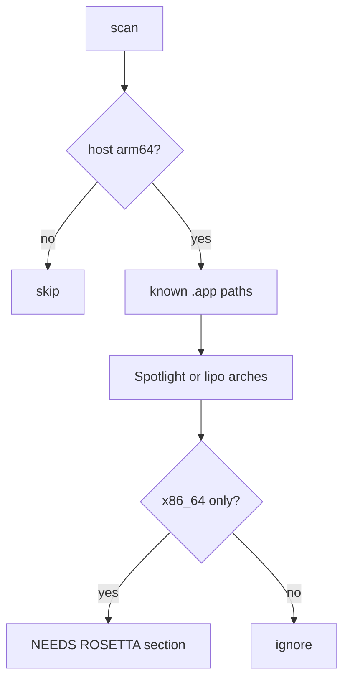

# Detect Rosetta-requiring apps

- **Task ID:** `detect-rosetta-apps`
- **Status:** backlog
- **Related:** `apps` source; scan report sections (DROP CANDIDATES / MISSING A REASON)

## Problem

On Apple Silicon, Intel-only (x86_64-only) apps need Rosetta to run. Apple is sunsetting
Rosetta; those installs become a real liability. vole already lists `.app` bundles but
never inspects architecture, so a scan cannot flag “will break when Rosetta goes away.”

Usage signals do not answer that question — an actively used Intel app is still a risk.

## Goal

On Apple Silicon, `vole scan` reports installed software whose **main executable is
Intel-only** (needs Rosetta). Intel Macs and dry discovery with no arch data stay silent.

## Open questions

Do not implement while any row is `open`.

| # | Topic | Status | Decision |
|---|--------|--------|----------|
| 1 | Detection API? | open | **Proposal:** Spotlight `kMDItemExecutableArchitectures` via `mdls` / `mdfind` (already used elsewhere for last-used). Fallback or alternate: `lipo -archs` on `Contents/MacOS/<CFBundleExecutable>`. Prefer Spotlight for speed; treat both `arm64` and `arm64e` as native |
| 2 | What counts as “needs Rosetta”? | open | **Proposal:** main executable has `x86_64` and **no** native slice (`arm64` / `arm64e`). Universal (both) = native, not flagged. Missing / unreadable arch = skip, no error |
| 3 | Scope — which installs? | open | **Proposal v1:** `.app` bundles vole already discovers (`app` / `app-store` / cask-owned apps in `/Applications` and `~/Applications`). **Not** brew formulae bottles, cargo/go/pipx shims, or Steam helpers in v1 |
| 4 | UX — how does scan surface it? | open | **Proposal:** new report section, e.g. `NEEDS ROSETTA (N):`, separate from DROP CANDIDATES. Do **not** auto-`keep` or auto-drop. Optional later: `get` / list column |
| 5 | Persist on inventory? | open | **Proposal:** **live-only** in v1 (recomputed each scan). No new `software.json` field / migration unless UX later needs a sticky note |
| 6 | Host gate? | open | **Proposal:** only classify on `arm64` hosts (`uname -m` / equivalent). On Intel Macs, skip the check entirely |
| 7 | Known false negatives OK? | open | **Proposal:** yes for v1 — universal host + Intel-only plugins/helpers can still need Rosetta; main-binary check misses them. Document in README rough edges |

## Non-goals

- Not detecting whether Rosetta itself is installed.
- Not uninstalling or rewriting apps; not forcing “Open using Rosetta” Finder flags.
- Not scanning every Mach-O under `/usr/local` or all PATH binaries in v1.
- Not a usage signal (does not advance `last_used`).
- Not inventoring script-only / no-binary bundles as Rosetta-required unless detection is unambiguous.

## Implementation sketch

- Pure classifier input: `{name → arch tags}` or a set of Intel-only names; keep I/O in a small helper under `vole/sources/` or `vole/signals/` (lean **sources** / scan helper — this is install shape, not usage).
- Unit-test the “needs Rosetta?” predicate with fixture arch lists; mock `mdls`/`lipo` at the boundary.
- PRIVACY.md: note that scan may read executable-architecture metadata (names/arches only).

## Done when

- [ ] On Apple Silicon, write and dry-run scan list Intel-only `.app` entries under a dedicated section.
- [ ] On Intel hosts (or when arch lookup fails), no section and no crash.
- [ ] Universal and arm64/`arm64e` apps are not flagged.
- [ ] Tests for the predicate + a mocked discovery path; README + PRIVACY updated.
- [ ] Open questions above locked before coding.

## Notes

- Spotlight set-difference pattern (Intel apps minus those also indexed as arm64) is what fleet/osquery guides use; avoids hand-parsing `arm64e`.
- `lipo -archs /Applications/Foo.app/Contents/MacOS/Foo` is the Apple-documented ground truth for a single binary.
- Product framing: complementary to Mole (cleanup) — vole answers “why keep an Intel-only app?” once the user sees the flag.
- Related macOS timeline: Apple has announced Rosetta 2 will not ship indefinitely; exact cutover is outside this task.
