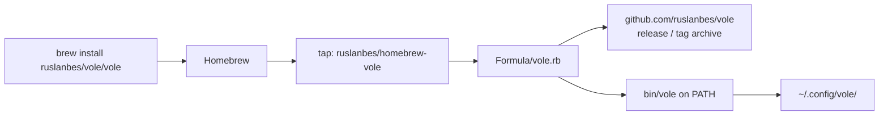

# Ship a Homebrew formula via a personal tap

- **Task ID:** `homebrew-formula`
- **Status:** ready
- **Progress:** local tap at `/opt/homebrew/Library/Taps/ruslanbes/homebrew-vole/`; GitHub `homebrew-vole` repo created. Still need `Formula/vole.rb` + a tagged vole release (`url`/`sha256`).
- **Blocked by:** `pre-release-review` (first tag waits on its **B** items)
- **Related:** `curl-install`
- **Upstream:** https://github.com/ruslanbes/vole/

## Problem

Install today is curl/`install.sh` or a clone. Homebrew users expect `brew install …`. That does
**not** require acceptance into homebrew-core — a personal/org tap is enough
([Homebrew tap docs](https://docs.brew.sh/How-to-Create-and-Maintain-a-Tap)).

## Goal

Users can install vole with Homebrew from a tap you control, fetching the app from
https://github.com/ruslanbes/vole/ (release tarball or git tag). Data stays in
`~/.config/vole/`. README documents the brew one-liner.

```sh
brew install ruslanbes/vole/vole
```

Homebrew auto-taps `ruslanbes/homebrew-vole`; thereafter `brew upgrade vole` works like any other formula.

## Open questions

| # | Topic | Status | Decision |
|---|--------|--------|----------|
| 1 | Core formula, personal tap, or both? | locked | **Personal tap first.** homebrew-core is optional later, not a gate for shipping |
| 2 | Where does the tap repo live? | locked | **Separate repo `ruslanbes/homebrew-vole`** with `Formula/vole.rb`. Users run `brew install ruslanbes/vole/vole` (Homebrew maps `ruslanbes/vole` → `homebrew-vole`). Upstream app stays https://github.com/ruslanbes/vole/ |
| 3 | Is the `vole` formula name free in homebrew-core / known taps? | locked | **Yes — free.** Unqualified `brew install vole` can work after the user has tapped (or via the fully qualified `ruslanbes/vole/vole` which always works) |
| 4 | Where do the data files live under brew? | locked | `~/.config/vole/` — decided in `python-only-restructure` |
| 5 | Formula `url` — git HEAD, tagged release, or stable tarball? | locked | **Tagged release / archive** on `ruslanbes/vole` — versioned `url` + `sha256`. No floating `main` |

## Non-goals

- Not requiring homebrew-core review to ship.
- Not installing via raw `brew install https://raw.githubusercontent.com/…/vole.rb` (Homebrew discourages / rejects GitHub formula URLs; use a tap).
- Not App Store / pkg distribution.
- Not replacing `curl-install` (secondary path stays).
- Not adding third-party Python deps to satisfy brew (stdlib-only runtime stays).

## How it works (tap, not core)



- Tap = https://github.com/ruslanbes/homebrew-vole (formula only).
- Upstream = https://github.com/ruslanbes/vole/ (the product).
- Core = not involved until/unless you open a homebrew-core PR later.

## Implementation sketch

- Create tap: `brew tap-new ruslanbes/homebrew-vole`, push to GitHub.
- `Formula/vole.rb`: `url`/`sha256` pointing at a tagged vole release archive on `ruslanbes/vole`; install the `vole/` package + launcher (mirror what `install.sh` does, brew-style).
- Depends on macOS + a `python@3.9`+ or uses system `python3` — decide in formula to match the 3.9 floor.
- README Install: `brew install ruslanbes/vole/vole` (and note curl fallback).
- Optional: GitHub Actions in the tap for bottles later — not required for v1.

## Done when

- [ ] Published tap `ruslanbes/homebrew-vole` installs the CLI as `vole` from a tagged archive on https://github.com/ruslanbes/vole/.
- [ ] README documents `brew install ruslanbes/vole/vole`.
- [ ] Re-install / upgrade path works (`brew upgrade` after a new tagged release + formula bump).

## Notes

- Curl install remains the zero-brew fallback (`curl-install`).
- Tap slug `ruslanbes/vole` → GitHub repo `ruslanbes/homebrew-vole`.
- All open questions locked — ready to implement when you cut a release tag and create the tap repo.
- **Launcher (review 4.11):** install the `vole/` package and a bin that ends at `vole.cli.main` (same as `bin/vole`, `__main__.py`, and `install.sh`) — or `python3 -m vole`. Do not invent a fifth entry path.
- **README (review 2.2):** once the tap works, list `brew install ruslanbes/vole/vole` first and curl as fallback.
