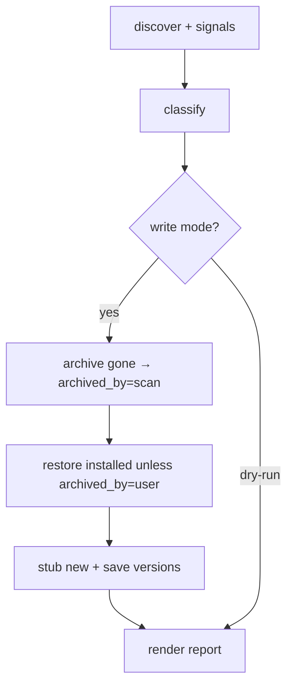

# Scan: auto-archive gone (default on); sticky manual drop

- **Task ID:** `scan-auto-archive`
- **Status:** done
- **Related:** `cli-restructure` (archive-on-edit), `cli-edit-coverage` (`drop` / `restore` stay as corrections)

## Problem

Scan already classifies mechanical install churn that today only shows up as chores:

1. **NO LONGER INSTALLED** — in `software.json`, absent from the machine → should archive
   itself (reason preserved in `dropped.json`).
2. **DROPPED BUT PRESENT** — in `dropped.json`, installed again → only some of these should
   come back. A **manual** `vole drop` must stay dropped even if the software is still (or
   again) on the machine; otherwise drop is useless for “ignore this install.”

Leaving (1) as report-only means every scan repeats the same archive list. Blindly
auto-restoring (2) undoes intentional drops (duplicates, MDM noise, “I know it’s there”).

## Goal

On a normal `vole scan` (write mode):

- **Auto-archive** entries that are gone from the machine (default **on**).
- **Never auto-restore** an entry the user dropped on purpose (`archived_by: user`).
- **Auto-restore** entries scan had archived (`archived_by: scan`) when they are installed
  again; also auto-restore legacy dropped rows with **no** `archived_by` when installed
  again (missing field = non-sticky).
- `vole drop` / `vole restore` remain the escape hatches when vole misdetects.
- Drop-candidate / missing-reason / `keep` judgment stays fully manual.
- `scan --dry-run` never moves entries. No opt-out flag for now.

## Open questions

| # | Topic | Status | Decision |
|---|--------|--------|----------|
| 1 | Default on? | locked | **Yes.** Write-mode `scan` auto-archives gone entries. No `--sync` flag |
| 2 | Sticky manual drop — how? | locked | Additive `"archived_by": "user"` on `vole drop` / `edit --status dropped`; `"archived_by": "scan"` when scan archives a gone entry. **Missing field = non-user, non-sticky** (eligible for auto-restore when installed). No format bump |
| 3 | Auto-restore scan-archived reinstalls? | locked | **Yes** — `archived_by == scan` and installed → restore. Missing `archived_by` + installed → restore as well. Only `archived_by == user` stays dropped |
| 4 | What is “gone”? | locked | Same as today’s `Report.gone` — active (non-dropped) row in `software.json`, not in `discover_all` |
| 5 | Report wording? | locked | Write mode: `ARCHIVED — no longer installed (N):` and `RESTORED — reinstalled after auto-archive (N):`. Sticky user drops that are still installed: `DROPPED BUT PRESENT` (fix with `vole restore`). `--dry-run`: suggestion-only for gone, no moves |
| 6 | Order vs stubs / versions? | locked | discover → classify → apply archive/restore moves → write stubs for still-new + versions → render |
| 7 | Opt-out flag in v1? | locked | **No** opt-out for now |

## Non-goals

- **Not** auto-dropping DROP CANDIDATES (stale / no signal).
- **Not** auto-`delete`.
- **Not** removing `drop` / `restore` / `edit --status` — they are the misdetection fix path; `drop` also means “stay ignored while installed.”
- **Not** a format version bump (additive `archived_by` only).
- **Not** an opt-out flag yet.

## Done when

- [x] Write-mode `scan` archives gone entries by default (`archived_by: scan`).
- [x] `vole drop` / `edit --status dropped` set `archived_by: user`; those never auto-restore.
- [x] Reinstall of `archived_by: scan` or missing `archived_by` auto-restores; `user` does not.
- [x] `--dry-run` moves nothing; report still explains what write mode would archive.
- [x] `drop` / `restore` still work (set/clear `archived_by` as needed on restore).
- [x] Tests for: gone→archive, sticky user drop while installed, scan-archive then reinstall→restore, missing-field + installed→restore, dry-run no-op.
- [x] README: default archive-gone; manual drop is sticky; restore/drop for fixes.

## Notes

| Case | Automatic on write scan? | Manual fix |
|------|--------------------------|------------|
| Gone from machine | Archive (`archived_by: scan`) | `restore` if wrong |
| Reinstalled after scan-archive | Restore | — |
| Dropped, no `archived_by` (legacy), installed | Restore | — |
| User `vole drop` | Stay dropped | `restore` if that was a mistake |
| Drop candidates | Never | `drop` / `keep` / `edit --why` |

`drop` / `restore` roles after this ships:

- **drop** — “ignore this on purpose” (sticky `archived_by: user`) or correct a false active entry.
- **restore** — “bring it back” after a sticky drop or a bad auto-archive (clear sticky).
